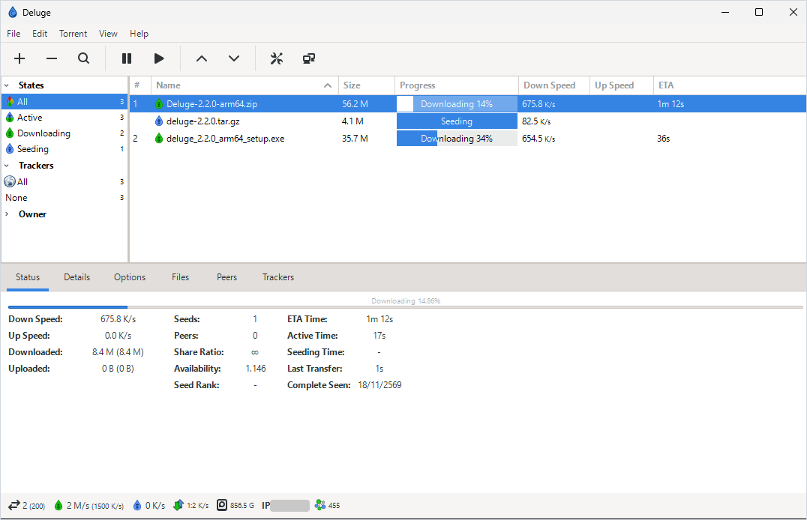

# Deluge for Windows on ARM

A native ARM64 build of the [Deluge](https://deluge-torrent.org/) BitTorrent client for Windows 11 on ARM.
Deluge's own Windows downloads are x86 and x64 only, so on a Snapdragon PC they run under emulation. This
build is ARM64 all the way down: the Python interpreter, GTK 3, libtorrent and every DLL.

Deluge 2.2.0 · libtorrent 2.1.2 · Python 3.14 · GTK 3 · portable zip or installer · unofficial build



*The GTK client, connected to a separate daemon, downloading this build's own release files from a local
seeder. The IP address in the status bar is blanked out.*

## Features

- **All of Deluge 2.2.0**: the GTK client, the daemon (`deluged`), the Web UI, the console client and the
  ten plugins that come with Deluge.
- **Both ways of running the GTK client**: on its own (standalone), or as a thin client of a separate
  daemon. Thin-client mode needed a fix in Twisted, see [What had to change](#what-had-to-change).
- **Portable**: unzip anywhere and run. There is nothing to install: no Python, no MSYS2, nothing added
  to PATH.
- **Installer**: Start Menu shortcuts, a desktop shortcut and `.torrent` and `magnet:` file
  associations (each can be turned off), and an uninstaller.

## Download and install

Download from [Releases](https://github.com/peekungdev/deluge-windows-arm64/releases/latest):

| File | What it is |
| --- | --- |
| `Deluge-2.2.0-arm64.zip` | Portable. Unzip anywhere and run `bin\Deluge.exe`. |
| `deluge_2.2.0_arm64_setup.exe` | Installer. Installs to `Program Files\Deluge` and needs administrator rights. |

The release notes list each file's SHA-256. The files are not code-signed, so Windows SmartScreen may
warn the first time: choose **More info › Run anyway**. The installer program itself is 32-bit x86
(NSIS), which Windows on ARM runs under emulation; everything it installs is ARM64.

Programs in `bin\`:

| Program | What it does |
| --- | --- |
| `Deluge.exe` | The GTK client (this is the one you want) |
| `deluged.exe` | The daemon, without a console window |
| `deluge-web.exe` | The Web UI, at `http://localhost:8112` |
| `deluge-console.exe` | The console client |
| `deluged-debug.exe`, `deluge-web-debug.exe` | The daemon and the Web UI with a console for log output |

Settings live in `%APPDATA%\deluge`. Start any of them with `-c <folder>` to keep settings somewhere
else, for example next to a portable copy.

## Things to know

- **If nothing ever connects, check the incoming port.** Windows reserves blocks of ports for Hyper-V,
  WSL and Docker, and the blocks move at every restart; on a PC with those, a tenth or more of the range
  Deluge picks its port from can be reserved. Deluge picks a random incoming port once and keeps it. If
  a restart puts that port inside a reserved block, libtorrent cannot listen on it, and a session that
  cannot listen makes no outgoing connections either, so nothing downloads at all.
  `netsh int ipv4 show excludedportrange protocol=tcp` lists the reserved blocks. In **Preferences ›
  Network › Incoming Port**, untick **Random** and choose a port outside them. The daemon's own port,
  58846 by default, can be caught the same way: `deluged` then stops with "listen port in use" even
  though nothing uses it, and a thin client cannot connect. Set another **Daemon port** under
  **Preferences › Daemon**, or `daemon_port` in `core.conf`. This is how upstream Deluge and libtorrent
  behave, not something this build adds.
- **Hybrid torrents added from v1-only magnet links.** If a magnet link has only a v1 hash
  (`xt=urn:btih:...`) and the torrent turns out to be a v1+v2 hybrid, Deluge loses track of it when the
  metadata arrives: it still downloads and seeds, but Deluge keeps showing it as Downloading with no files.
  This is a Deluge 2.2.0 bug that also happens with libtorrent 2.0, and upstream Deluge has not fixed it.
  Adding the `.torrent` file instead, or a magnet link that also has the v2 hash (`xt=urn:btmh:...`),
  avoids it.
- **A daemon and a GTK client on the same PC** log in with the `localclient` password from each one's own
  settings folder. If they use different folders, copy the daemon's `auth` file into the client's folder.
- The files are not signed, see above.

## What had to change

Deluge 2.2.0 came out before Python 3.14, libtorrent 2.1 and today's MSYS2 packages, and Twisted 26 broke
its GTK support on Windows. Running it natively took these changes, all in [`patches/`](patches) and
applied by the build scripts:

1. **libtorrent's Python module.** There is no ARM64 wheel, and MSYS2 ships libtorrent without Python
   bindings, so they are compiled from source against MSYS2's Boost.Python. clang 23 also needs two
   one-line `#include` fixes that libtorrent has upstream but not yet in a release.
2. **pywin32** cannot be loaded by this Python, yet Deluge imports it unconditionally on Windows. The few
   Win32 calls Deluge makes are reimplemented with ctypes in [`pywin32-shim/`](pywin32-shim).
3. **Twisted 26's GTK reactor on Windows** crashed at start-up, and with that fixed it still never
   delivered a socket event, so the GTK client could not talk to a daemon: every daemon showed as Offline.
   The patch brings back the select()-based reactor Twisted used to have for Windows.
4. **pyOpenSSL 26** removed the API Deluge used to create the daemon's certificate. It now uses
   `cryptography`.
5. **The single-instance socket** used a random port, sometimes one that Windows reserves for Hyper-V or
   WSL, and then Deluge quit before showing a window. It now lets Windows choose a free port.
6. **libtorrent 2.1** removed about 20 functions, fields and settings that Deluge uses; without the patch
   Deluge cannot even start its session. Each replacement gives the same values on libtorrent 2.0.

There are also two smaller fixes: `pkg_resources`, which Deluge's plugin loader needs and setuptools no
longer includes, and a traceback in the console client. The full story, with the evidence for each change,
is in [`README-arm64-build.txt`](README-arm64-build.txt), which is also included in the download.

## Building from source

Requirements:

- A Windows 11 ARM64 PC.
- [MSYS2](https://www.msys2.org/), building in its CLANGARM64 environment. The scripts install the MSYS2
  packages they need with pacman.
- [Git for Windows](https://gitforwindows.org/) (the CLANGARM64 environment has no git of its own).
- [NSIS 3](https://nsis.sourceforge.io/) for the installer.

In an MSYS2 CLANGARM64 shell:

```sh
git clone https://github.com/peekungdev/deluge-windows-arm64
cd deluge-windows-arm64
./build-libtorrent.sh   # libtorrent 2.1.2 and its Python module (a few minutes)
./install-deluge.sh     # dependencies, Deluge 2.2.0 and the patches
./deploy.sh             # the portable folder, in dist/
python magtest/e2e.py dist/Deluge-2.2.0-arm64   # optional: check it end to end
```

Then `makensis installer\deluge.nsi`, from any Windows shell, makes the installer in `dist\`.

`install-deluge.sh` installs Deluge into MSYS2's own Python and patches the Twisted installed there, so use
an MSYS2 installation that you keep for building. `deploy.sh` copies only what Deluge needs, following
Deluge's dependency tree instead of taking everything installed in MSYS2, and two runs of it give
byte-identical results.

| Path | Contents |
| --- | --- |
| `build-libtorrent.sh`, `install-deluge.sh`, `deploy.sh` | The build |
| `patches/` | The patches to Deluge, Twisted and libtorrent |
| `pywin32-shim/` | The ctypes stand-in for pywin32 |
| `launcher/` | The `bin\*.exe` launchers |
| `installer/` | The NSIS script |
| `collect-site-packages.py`, `prune-pixbuf-loaders.py` | Decide what goes into the portable folder |
| `verify-*.py`, `stage-tests.sh`, `run-core-tests.sh`, `lt-field-compare.py`, `magtest/` | Tests |

## Tests

- `verify-lt-api.py` checks that every libtorrent function and field Deluge uses exists in the built
  module: 183 checked, none missing.
- `verify-reactor.py` checks that the GTK reactor can send and receive on a socket. Without the Twisted
  patch it fails.
- `verify-bundle-imports.py` imports all 152 Deluge modules and loads its 32 UI and plugin entry points.
  Run with the portable folder's own Python it gives the same result as with MSYS2's, with no failures,
  so nothing Deluge needs was left out of the folder.
- `stage-tests.sh` and `run-core-tests.sh` run Deluge's own core tests against the patched Deluge: 119
  pass. The one failure, `test_test_listen_port`, needs a server on the internet that can connect back
  to the PC running the tests. Without the libtorrent 2.1 patch, 64 of the tests error before they start.
- `magtest/e2e.py` checks a portable folder from end to end, with scratch settings so your own are never
  touched. `magtest/seeder.py` seeds a random file on 127.0.0.1, the folder's own daemon is given only
  a magnet link for it, and it has to fetch the metadata, download the file with the same SHA-256 and
  seed it. Then the GTK client has to open its window and close again. It works on your own build or
  on a downloaded release, from a checkout of this repository: `python magtest/e2e.py <portable folder>`.
- Builds are reproducible. Two fresh clones of this repository, built in different folders on the same
  MSYS2 installation, gave portable folders that are identical byte for byte except the ten plugin
  eggs. Even those have identical contents, but Deluge's build stamps every file in an egg with the
  time it was zipped, and pip's `RECORD` file lists the eggs' hashes. MSYS2 is a rolling distribution,
  so building later picks up newer packages.

The release files are one of those two builds, and they passed every check above.

Not yet tested:

- running the installer (it has been built, never installed)
- downloading from public swarms through trackers (tested with local peers; DHT connects)
- using the Web UI beyond starting it
- the plugins beyond loading them
- building on a brand-new MSYS2 installation

## Licence and credits

- [Deluge](https://deluge-torrent.org/) is by the Deluge Team (GPL-3.0-or-later, with an OpenSSL linking
  exception). [libtorrent](https://libtorrent.org/) is by Arvid Norberg (BSD-3-Clause). The portable
  folder also contains Python, GTK, Twisted, OpenSSL, Boost and other libraries from
  [MSYS2](https://www.msys2.org/), each under its own licence.
- The scripts, patches and launcher in this repository are released under the same terms as Deluge, see
  [LICENSE](LICENSE).
- This is an unofficial build. It is not affiliated with or endorsed by the Deluge Team.
